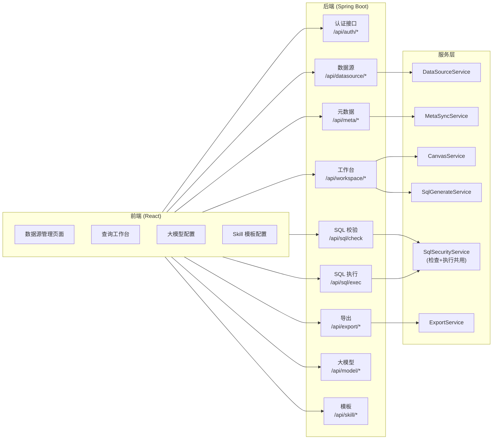
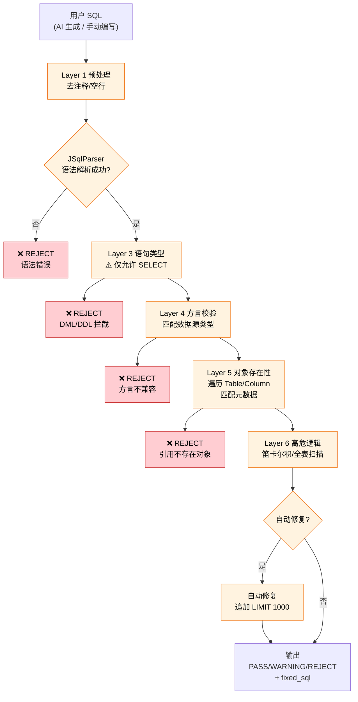
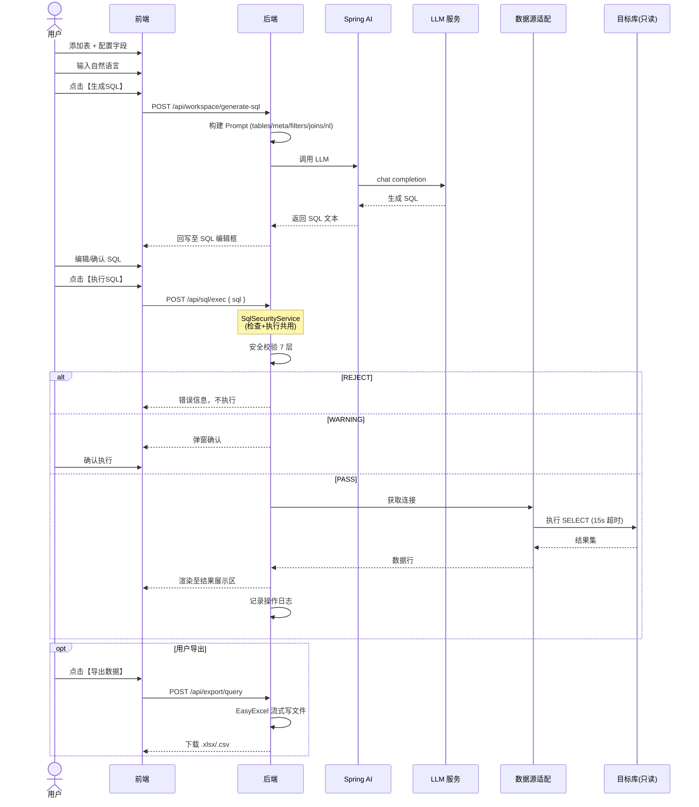
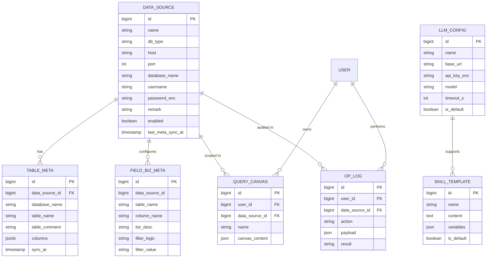

# 系统架构图 (Mermaid)

> 文档版本: V1.3 | 适用于内网私有化部署

## 1. 部署架构图

```mermaid
flowchart TB
    subgraph CLIENT["用户客户端"]
        Browser["浏览器<br/>(Chrome/Edge/Firefox)"]
    end

    subgraph NGINX["Nginx 反向代理"]
        Static["静态资源服务<br/>dist/*"]
        Proxy["/api 反向代理"]
    end

    subgraph BACKEND["Spring Boot 单体应用 (内嵌 Tomcat)"]
        direction TB
        API["REST API<br/>nl2sql-api"]
        Core["业务核心<br/>nl2sql-core"]
        subgraph ENGINES["核心引擎"]
            direction LR
            AIP["AI 适配<br/>Spring AI"]
            Parser["SQL 解析<br/>JSqlParser"]
            DS["多数据源<br/>HikariCP"]
            Export["导出引擎<br/>EasyExcel"]
            Sec["安全<br/>JWT + AES"]
        end
    end

    subgraph DATA["数据存储"]
        direction LR
        PG[("PostgreSQL 16<br/>业务元数据")]
        Redis[("Redis 7<br/>缓存/会话")]
        TargetDB[("目标库<br/>MySQL/PG/Oracle<br/>⚠️ 只读账号")]
    end

    LLM["LLM 服务<br/>(Ollama/OpenAI/通义等)"]

    Browser -->|HTTPS| NGINX
    NGINX --> Browser
    NGINX -->|静态文件| Static
    NGINX -->|反向代理| Proxy
    Proxy --> API
    API --> Core
    Core --> AIP
    Core --> Parser
    Core --> DS
    Core --> Export
    Core --> Sec
    DS ==>|"⚠️ 只读连接<br/>强制 SELECT"| TargetDB
    AIP -->|"http/https"| LLM
    Core -->|JPA/MP| PG
    Core -->|缓存| Redis
    Sec -->|会话| Redis

    classDef danger fill:#ffcdd2,stroke:#c62828,stroke-width:2px
    classDef warning fill:#fff3e0,stroke:#ef6c00,stroke-width:2px
    classDef safe fill:#e8f5e9,stroke:#2e7d32,stroke-width:2px
    class Def neutral fill:#e3f2fd,stroke:#1565c0
    class Parser,TargetDB danger
    class DS warning
    class PG,Redis safe
```

## 2. 业务模块架构



## 3. SQL 安全校验引擎（核心防御）



## 4. 全链路业务流程（NL2SQL 查询）



## 5. 数据模型 ER 图


